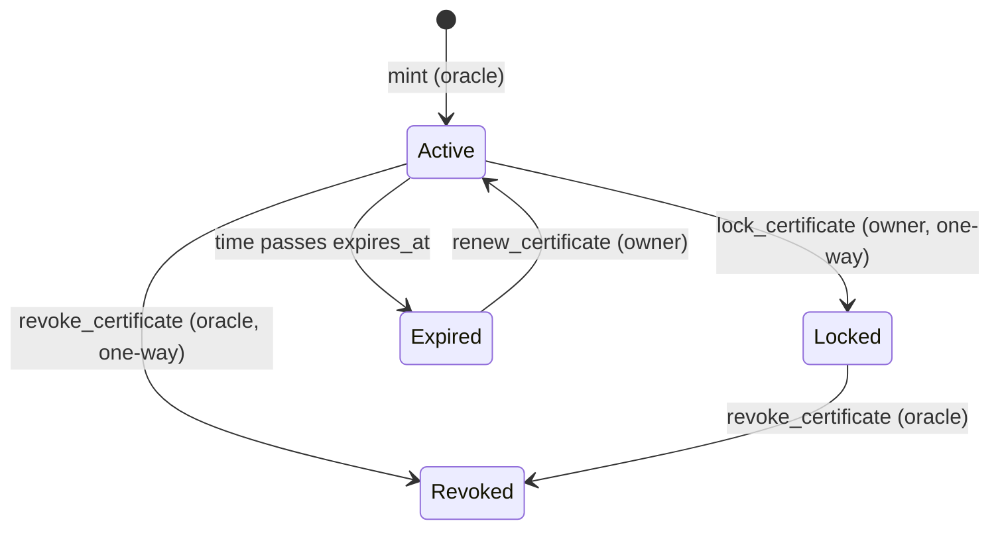
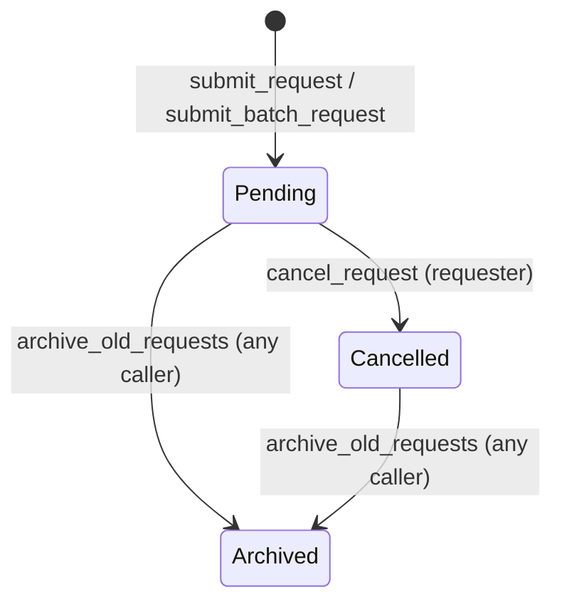
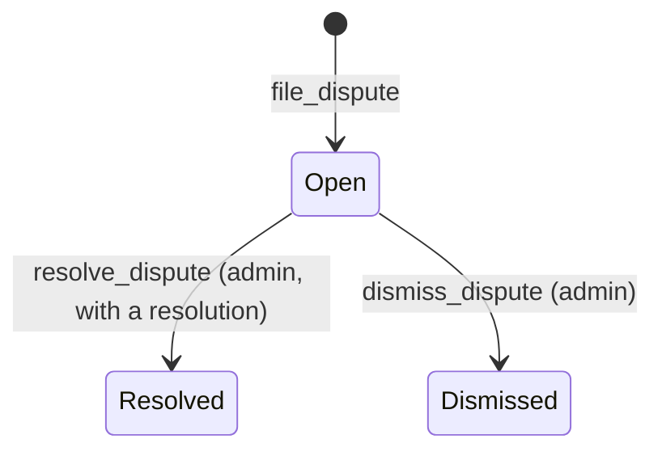
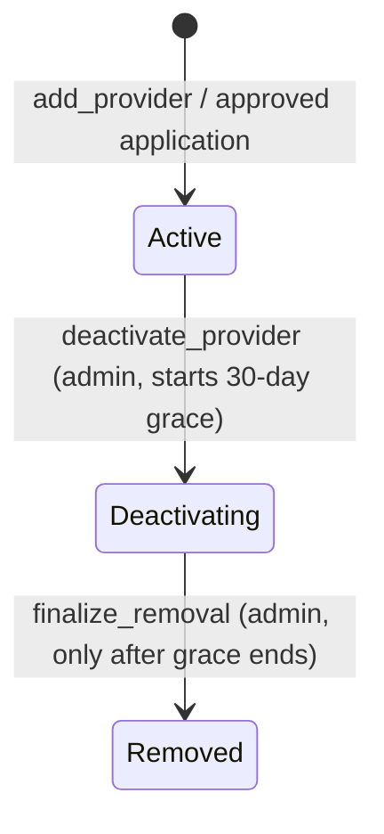
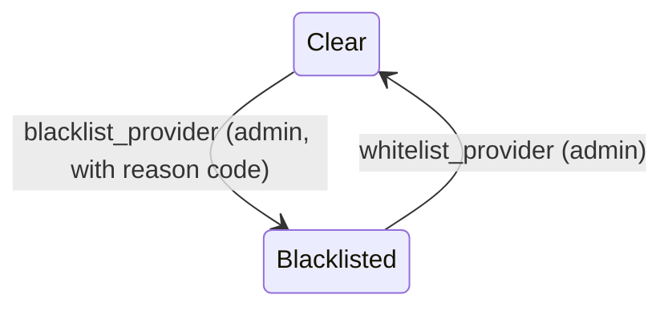
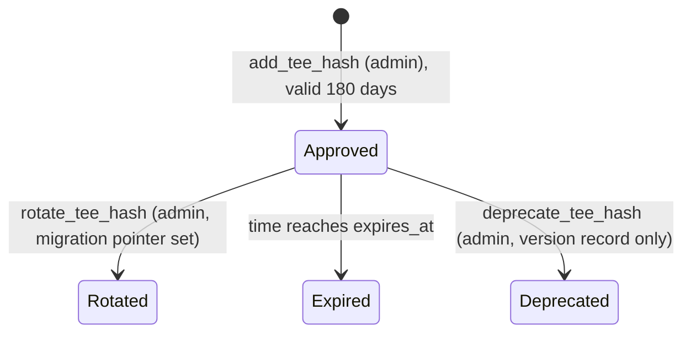

# Contract State Transitions

This document describes how records move between states in the three Soroban
contracts (`provenance`, `oracle`, `registry`), and how external systems should
read those states. It is written from the contract source, so a reader can
trace each claim to a function without reading the whole crate.

Where the code and the design docs disagree, the difference is listed under
[Known gaps](#known-gaps) rather than smoothed over.

## Contents

- [Provenance certificates](#provenance-certificates)
- [Oracle verification requests](#oracle-verification-requests)
- [Oracle disputes](#oracle-disputes)
- [Registry providers](#registry-providers)
- [Registry TEE code hashes](#registry-tee-code-hashes)
- [Reading state from outside the contracts](#reading-state-from-outside-the-contracts)
- [Known gaps](#known-gaps)

---

## Provenance certificates

A certificate is stored under its numeric id. Its lifecycle flags are fields on
`ProvenanceCert`, and its owner is kept separately (see below).

`Locked`, `Revoked` and `Expired` are independent flags, not one linear
sequence. A certificate can be locked and revoked at once, and expiry is
derived from the ledger clock, not stored as a state change.

### Operations

| Operation | Who may call | Precondition | Effect | Errors |
| --- | --- | --- | --- | --- |
| `mint` | Oracle (`require_auth`) | `manifest_hash` not already minted | Creates the record: `revoked = false`, `locked = false`, `expires_at = None`, owner = creator | Panics on duplicate manifest hash (not a `ProvenanceError`) |
| `transfer_certificate` | Current owner | Not locked; new owner differs from current | Sets the owner, appends a `transferred` history entry | `CertificateLocked`, `InvalidOwner`, `CertificateNotFound` |
| `lock_certificate` | Current owner | None | Sets `locked = true`. Calling again is a no-op | `CertificateNotFound` |
| `revoke_certificate` | Oracle (`require_auth`) | None | Sets `revoked = true`, the reason and the timestamp. Calling again overwrites the reason and timestamp | `CertificateNotFound` |
| `set_expiration` | Current owner | New deadline is in the future, or `None` to clear | Sets or clears `expires_at` | `InvalidExpiration`, `CertificateNotFound` |
| `renew_certificate` | Current owner | New deadline is in the future | Sets `expires_at` | `InvalidExpiration`, `CertificateNotFound` |
| `update_metadata`, `add_tag`, `remove_tag`, `set_tags` | Owner-gated | Not locked | Changes metadata or tags | `CertificateLocked` |
| `record_rollback` | Any `initiated_by` address that authenticates (see [Known gaps](#known-gaps)) | None | Appends an audit record only. The certificate's manifest hash is **not** changed | — |

### Rules to know

- **Revocation is one-way.** No function clears `revoked`.
- **Locking is one-way.** No function unlocks a certificate.
- **Expiry is strict.** `is_certificate_expired` is true only when the ledger
  time is *after* `expires_at`. At exactly `expires_at` the certificate is
  still valid.
- **Expiry changes are not blocked by lock or revocation.** `set_expiration`
  and `renew_certificate` do not check the `locked` or `revoked` flags.
- **Rollback is an audit trail, not a state change.** Read the rollback history
  with `get_rollback_history`. To learn the current manifest, read the
  certificate.

### Events

Subscribe to these to follow changes without polling:

`CertificateMinted`, `CertificateTransferred`, `CertificateLockedEvent`,
`CertificateRevoked`, `CertificateRenewed`, `CertificateExpirationWarning`,
`MetadataUpdated`, `VerificationLevelUpdated`, `CertificatesLinked`,
`CertificateEndorsed`, `EndorsementRemoved`, `AnchorAdded`, `BatchMinted`,
`rollback_recorded`, `manifest_signed`, `redaction_policy_set`,
`redaction_approved`, `tag_add`, `tag_rm`, `tag_set`.

---

## Oracle verification requests

`RequestState` has four variants. Only two are reachable in the current code:

- **`Verified` and `Rejected` are declared but never assigned** by any function
  in the oracle. Nothing in the contract moves a request to either state.
  Attestation is checked by `verify_attestation`, which returns success or an
  error and does not write request state. Treat a request as "verified" only
  when an off-chain process has confirmed it, and do not rely on `RequestState`
  for that.
- **Cancellation** is allowed only from `Pending`. Any other state returns
  `InvalidState`. The requester must authenticate.
- **Archival** moves every live request out of temporary storage into
  `ArchivedRequest` after `ARCHIVAL_THRESHOLD_LEDGERS` (1000) ledgers since the
  last archival. It does not check state, so a `Pending` request can be
  archived. It also has no `require_auth`, so anyone can trigger it once the
  threshold has passed. After archival, `get_request` returns `None`. Use
  `get_archived_request` instead.
- **Pause** blocks new submissions while paused (`pause` / `unpause`).

---

## Oracle disputes

- `resolve_dispute` and `dismiss_dispute` both require the dispute to be `Open`,
  and return an error otherwise. A dispute can leave `Open` only once.
- `resolution` stays `Pending` until a dispute is resolved. A dismissed dispute
  keeps `Pending`, so check `state`, not `resolution`, to see if it's closed.
- When a resolution is `ProviderFault`, the provider's metrics take a synthetic
  failure. Other resolutions leave the metrics unchanged.
- Evidence is attached with `anchor_dispute_evidence` while the dispute is open,
  and is readable with `get_dispute_evidence`.

---

## Registry providers

A provider has two independent facts: whether it is **registered and in which
status**, and whether it is **blacklisted**.

Blacklisting is a separate flag:

| Question | Function | Answer |
| --- | --- | --- |
| Can this provider take new requests? | `can_accept_new_requests` | Only when `Active` |
| Is this key registered at all? | `is_provider` | True for `Active` and `Deactivating`. False for `Removed`. **Ignores the blacklist** |
| Is this provider allowed to act? | `is_provider_authorized` | Returns `Err(ProviderBlacklisted)` when blacklisted, otherwise true when registered |

- `finalize_removal` panics with "Grace period not elapsed" before the grace
  period ends.
- An application goes `Pending` → `Approved` or `Rejected` through
  `review_application`. Approval registers the applicant's key as an `Active`
  Basic-tier provider.
- `review_application` does not check the current status. Reviewing an
  application again can change its status, and rejecting an approved application
  does not remove the provider. See [Known gaps](#known-gaps).

---

## Registry TEE code hashes

`is_tee_hash_approved` returns true only when the hash is registered, **not
rotated**, and the ledger time is **before** `expires_at`.

- `rotate_tee_hash` marks the old hash rotated, stores the new hash as its
  replacement (`get_tee_hash_migration`), and approves the new hash.
- `deprecate_tee_hash` records a deprecation in the version history. It does
  **not** change what `is_tee_hash_approved` returns. See
  [Known gaps](#known-gaps).
- `is_tee_hash_near_expiry` lets operators rotate before expiry.

---

## Reading state from outside the contracts

| You want to know | Read | Notes |
| --- | --- | --- |
| Is a certificate currently valid? | `get_certificate`, then `revoked` and `is_certificate_expired` | Locked is not invalid |
| Who owns a certificate? | `get_owner` | Falls back to the creator if no transfer has happened |
| Was a certificate revoked, and why? | `get_certificate`: `revocation_reason`, `revocation_timestamp` | Reason is overwritten by a repeat revoke |
| Is an oracle request still open? | `get_request` | `None` can mean archived. Check `get_archived_request` |
| Is a dispute still open? | `get_dispute`: `state` | Check `state`, not `resolution` |
| Can this provider act now? | `is_provider_authorized` and `can_accept_new_requests` | Do not use `is_provider` alone |
| Is this TEE hash acceptable? | `is_tee_hash_approved` | Also check `get_tee_hash_migration` if it was rotated |

---

## Known gaps

These are places where current behaviour differs from what a reader would
expect, or from what the repo's tests or design docs say. Each needs a decision
from maintainers before the behaviour is changed.

1. **Locked certificates can still be revoked.** `revoke_certificate` does not
   check `locked`. A test (`test_lock_certificate_prevents_further_changes`)
   expects revocation to fail on a locked certificate. The test currently fails.
2. **Revoking twice is allowed.** A repeat revoke overwrites the reason and
   timestamp. A test (`test_revoke_already_revoked_returns_error`) expects an
   error. The test currently fails.
3. **Revoked certificates can be transferred.** `transfer_certificate` checks
   only `locked`.
4. **Who may revoke differs from the design doc.** `revoke_certificate` requires
   the oracle. [`docs/security/consent-model.md`](../security/consent-model.md)
   lists the creator (own certificate) and the admin as able to revoke.
5. **`RequestState::Verified` and `Rejected` are unused** (see above).
6. **Archival includes `Pending` requests and is permissionless** (see above).
7. **A deprecated TEE hash still passes `is_tee_hash_approved`.**
8. **`is_provider` ignores both removal grace and blacklisting** (see above).
   Callers must use `is_provider_authorized` for an access decision.
9. **Re-reviewing an application changes its status without a check**, and
   rejecting an approved application leaves the provider registered.
10. **`record_rollback` is not restricted to the oracle or admin.** Its doc comment
    says "Callable only by the oracle or admin", but the function only requires
    that `initiated_by` authenticates.

Related: [`docs/verification_pipeline.md`](../verification_pipeline.md),
[`docs/api/CONTRACTS.md`](../api/CONTRACTS.md),
[`docs/testing/contract-smoke-tests.md`](../testing/contract-smoke-tests.md).
